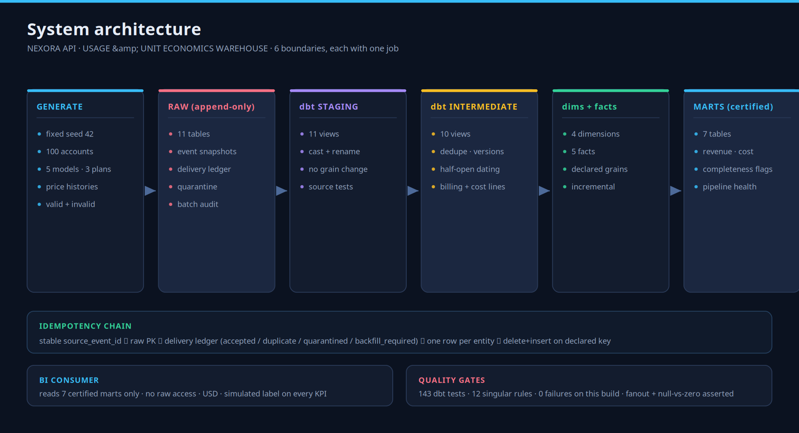
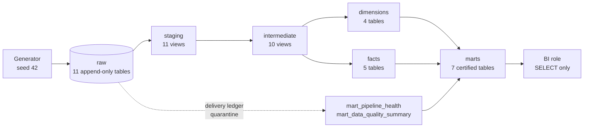
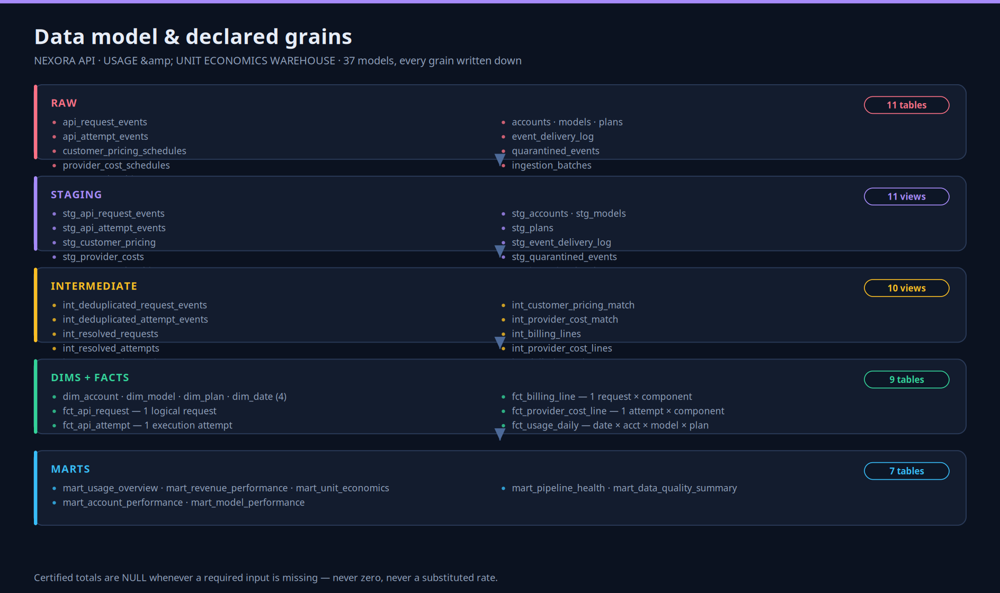
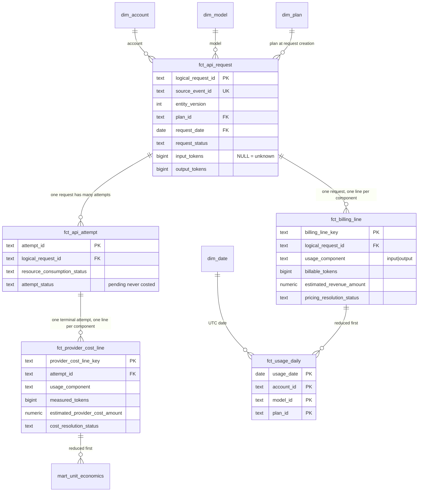
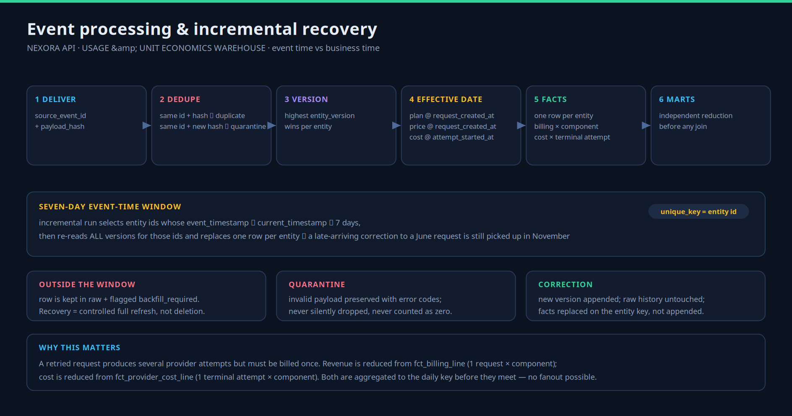
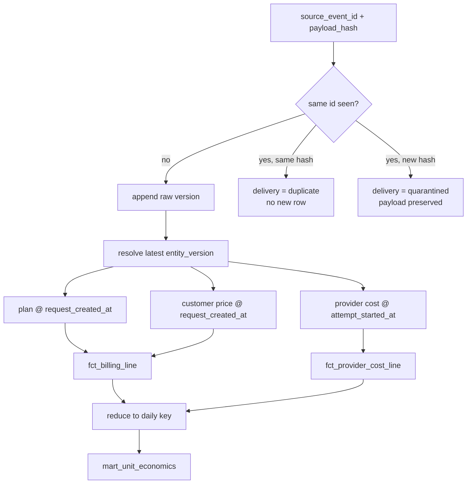
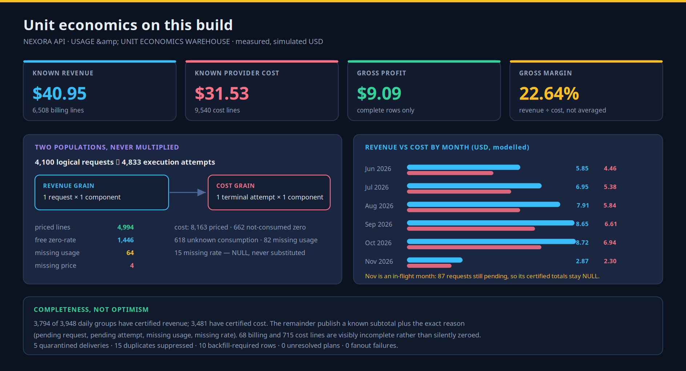

# API Usage & Unit Economics Warehouse

<p align="center">
  
</p>

<p align="center">
  <b>One logical customer request is not one provider attempt.</b><br>
  A retried request can be billed once and cost three times. This warehouse models both populations separately,
  then reconciles them — so revenue is never multiplied by retries and failed work never disappears.
</p>

<p align="center">
  
  
  
  
  
  
  
</p>

> **Simulation notice.** Nexora API is fictional. Every account, request, attempt, price, cost, revenue
> figure and margin in this repository is synthetically generated for portfolio demonstration. Nothing
> here is observed financial data, a production billing ledger, or a claim about any real company.

---

## 1. The problem in one picture

<table>
<tr>
<td width="50%" valign="top">

**What a naive model does**

A customer retries. Three provider attempts are written. If you join requests to attempts and sum
revenue, you bill the customer three times and overstate usage — while a `COUNT(DISTINCT request)`
elsewhere quietly reports the truth. Two numbers, both "right", that disagree.

</td>
<td width="50%" valign="top">

**What this warehouse does**

Revenue is reduced from `fct_billing_line` — **one successful request × one usage component**, at most
two rows per request. Cost is reduced from `fct_provider_cost_line` — **one terminal attempt × one
component**, which still counts the failed attempts the customer never paid for. Each is aggregated to
the daily key *before* they are joined.

</td>
</tr>
</table>

On this build: **4,100 logical requests → 4,833 execution attempts** (1.20 attempts per request), with
614 requests retried twice and 91 retried three times. Revenue lines stay at 6,508 — never 9,540.

---

## 2. Architecture

<p align="center">
  
</p>



| Boundary | Owns | Must not own |
|---|---|---|
| Generator | Distributions, deterministic IDs, planned edge cases | Metric definitions |
| Raw | Accepted snapshots, immutable corrections, audit + quarantine | Aggregates |
| Staging | Casting, renaming, UTC normalisation | Business metrics |
| Intermediate | Version resolution, effective dating, billability | Presentation |
| Dims & facts | Declared grains, atomic measures | Combining incompatible grains |
| Marts | Certified metrics + completeness state | Re-deriving pricing |

---

## 3. Data model and declared grains

<p align="center">
  
</p>



### The five grains, stated explicitly

| Model | Grain | Rows here | Why this grain |
|---|---|---:|---|
| `fct_api_request` | **one resolved logical request** | 4,100 | the billing unit |
| `fct_api_attempt` | **one resolved execution attempt** | 4,833 | the cost unit base |
| `fct_billing_line` | **one successful request × component** | 6,508 | max 2 rows per request |
| `fct_provider_cost_line` | **one terminal attempt × component** | 9,540 | failed attempts still cost |
| `fct_usage_daily` | **date × account × model × plan** | 3,948 | plan kept so plan filters stay valid across a mid-day upgrade |

`plan_id` is in the daily grain deliberately: an account that upgrades mid-day would otherwise mix two
plan assignments into one row and silently corrupt any plan-level filter.

---

## 4. How a request becomes money

<p align="center">
  
</p>



Three rules carry most of the correctness:

**Half-open effective dating.** `valid_from <= timestamp < valid_to`, `NULL valid_to` = open ended. A gap
in the schedule yields `missing_price` — never the latest rate reused. The seed data contains a real gap
(2026-07-01 → 2026-07-04, `model_text_03` / Starter / output) producing 4 `missing_price` lines rather
than 4 fabricated ones.

**NULL is unknown, 0 is measured zero.** `NULL` tokens stay `NULL` all the way to the mart and are
counted as missing; an explicit `0` survives aggregation as `0`. No `COALESCE(tokens, 0)` exists anywhere.
`tests/null_vs_zero_semantics.sql` fails the build if the two ever blur.

**Completeness beats optimism.** A certified total is `NULL` unless every contributing input is present.
The known subtotal and the exact count of incomplete lines are published next to it, so a reviewer sees
"$X known, 12 lines incomplete" rather than a confident wrong number.

### Incremental processing (event time, not business time)

The four fact models are incremental with `delete+insert` on the entity key:

1. Find entity IDs whose `event_timestamp >= current_timestamp - interval '7 days'`.
2. Re-read **all** versions for those IDs — not just the recent slice.
3. Resolve the highest version, replace one row per entity.

This is what makes a late correction to a *June* request pickable in *November*: eligibility is event
time, the replacement unit is the whole entity. `fct_usage_daily` and all marts are full-recompute
tables, so no stale aggregate can survive behind a corrected fact.

---

## 5. Measured results on this build

<p align="center">
  
</p>

| Metric | Value | Note |
|---|---:|---|
| Known simulated revenue | **$40.95** | sum of every priced billing line |
| Certifiable simulated revenue | **$40.16** | rows where nothing is pending/incomplete |
| Known modelled provider cost | **$31.53** | sum of every priced cost line |
| Certifiable provider cost | **$29.47** | |
| Certified gross profit | **$9.09** | only where both sides complete |
| Certified gross margin | **22.64%** | aggregate profit ÷ aggregate revenue |

Margin is always recomputed from aggregated revenue and cost. It is never summed or averaged from daily
percentages — that is the classic silent unit-economics error.

### By month (aggregated, not averaged)

| Month | Requests | Known revenue | Known cost | Certified profit | Margin |
|---|---:|---:|---:|---:|---:|
| 2026-06 | 620 | $5.85 | $4.46 | $0.75 | 14.02% |
| 2026-07 | 680 | $6.95 | $5.38 | $0.54 | 9.41% |
| 2026-08 | 740 | $7.91 | $5.84 | $0.92 | 13.85% |
| 2026-09 | 800 | $8.65 | $6.61 | $0.72 | 11.05% |
| 2026-10 | 860 | $8.72 | $6.94 | $0.81 | 11.70% |
| 2026-11 | 400 | $2.87 | $2.30 | $0.25 | 22.12% |

November is an in-flight month — 87 requests are still `pending`, so its certified totals are `NULL` and
only the known subtotal is reported. That is the completeness model working, not a bug.

### By model

| Model | Requests | Revenue | Read |
|---|---:|---:|---|
| `model_reason_01` | 609 | $18.04 | premium pricing, low volume, highest revenue |
| `model_text_01` | 1,231 | $16.72 | the volume workhorse |
| `model_text_02` | 1,028 | $4.43 | mid-tier |
| `model_text_03` | 807 | $1.70 | cheap tier |
| `model_embed_01` | 425 | $0.07 | input-only pricing |

### By plan

| Plan | Requests | Revenue | Note |
|---|---:|---:|---|
| Starter | 1,381 | $21.07 | 1.25× rate multiplier |
| Business | 1,676 | $19.88 | highest volume, 1.0× multiplier |
| Free | 891 | $0.00 | explicit zero-price lines, never paid usage |

---

## 6. Data quality — the part that is easy to fake

| Signal | Count | What it proves |
|---|---:|---|
| Accepted deliveries | 9,088 | |
| Duplicate deliveries suppressed | 15 | same ID + same hash produced no second row |
| Quarantined deliveries | 5 | invalid payloads preserved with error codes |
| Backfill-required rows | 10 | outside the 7-day window, kept and flagged |
| Corrected requests (`entity_version > 1`) | 96 | highest version won, history intact |
| Pending requests / pending attempts | 87 / 63 | drive completeness to `FALSE`, never to zero |
| Billing lines incomplete | 68 | 64 missing usage, 4 missing price |
| Provider cost lines incomplete | 715 | 618 unknown consumption, 82 missing usage, 15 missing rate |
| Unresolved plans | **0** | would be counted, not dropped |
| Fanout failures | **0** | atomic total == mart total, asserted |

`warehouse_is_certified = FALSE` is the correct answer for this build: there are open quarantines and
pending records. A dashboard claiming otherwise would be lying.

---

## 7. Test strategy — 142 checks that can fail

| Layer | Tests | Examples |
|---|---:|---|
| Schema / column | 129 | `not_null`, `unique`, `relationships`, `accepted_values`, custom `unique_combination_of_columns` on every declared grain |
| Singular business rules | 13 | see below |

The thirteen singular tests are the ones that would catch a plausible-looking wrong answer:

| Test | Fails when |
|---|---|
| `no_financial_fanout` | atomic billing total ≠ any mart total (retries multiplied revenue) |
| `billing_business_rules` | a non-succeeded request is billed, a Free line is paid, or a priced line lacks a rate |
| `provider_cost_business_rules` | a pending attempt is costed, or `not_consumed` isn't exactly zero |
| `reconciliation_units_daily` | daily billable tokens ≠ atomic billing sum |
| `reconciliation_request_counts` | daily counts ≠ request fact counts |
| `completeness_rules` | a certified total is non-NULL while its flag is `FALSE` (or vice versa) |
| `null_vs_zero_semantics` | NULL usage and measured zero are conflated |
| `pricing_interval_overlap` | two customer prices are effective at once |
| `provider_cost_interval_overlap` | two provider costs are effective at once |
| `account_plan_interval_overlap` | an account has overlapping plan assignments |
| `request_attempt_model_consistency` | an attempt's model ≠ its parent request's model |
| `late_event_within_window` | an in-window event is missing from the facts |
| `event_model_reference_validity` | a request/attempt references a model absent from `stg_models` |

---

## 8. Where the specs were ambiguous, and what I chose

Seven real defects were found between the PRD and TAD. Full reasoning in
[`docs/DECISIONS.md`](docs/DECISIONS.md); the short version:

| # | Defect | Resolution |
|---|---|---|
| F-01 | Dashboard must show quarantine counts, but BI may only read 5 marts | added `mart_pipeline_health`, `mart_data_quality_summary` |
| F-02 | Daily margin mixes request-date revenue with attempt-date cost | certify monthly economics; document daily as uncohort |
| F-04 | "Complete month" undefined, no flag | added `month_is_complete`; growth NULL when either side incomplete |
| F-05 | "Terminal attempt" never enumerated | `terminal := attempt_status <> 'pending'` |
| F-06 | NULL plan could be dropped while completeness said TRUE | `plan_unresolved` sentinel + unresolved-plan counter |
| F-07 | Free lines with unknown usage | block usage completeness, never revenue completeness |
| F-09 | Affected-key propagation across 5 mart layers | facts incremental, aggregates full rebuild |

**One stated deviation:** the TAD specifies PostgreSQL; this runs on DuckDB so a reviewer or CI job needs
no server. Every construct used is PostgreSQL-compatible — switching is a `profiles.yml` block plus the
`raw` DDL, not a model rewrite.

---

## 9. Run it

```powershell
pip install -r requirements.txt
python ingestion/generate_data.py          # deterministic: seed 42
dbt seed   --profiles-dir profiles --full-refresh
dbt build  --profiles-dir profiles          # 37 models + 142 tests
python scripts/report.py                    # certified totals
```

Expected final line: `Done. PASS=190 WARN=0 ERROR=0 SKIP=0 TOTAL=190`

| Command | Purpose |
|---|---|
| `dbt build --full-refresh` | rebuild everything from raw (recovery path for out-of-window events) |
| `dbt test --select result:fail` | list failing checks only |
| `dbt docs generate && dbt docs serve` | full lineage + column docs |

---

## 10. Layout

```text
nexora_usage_economics/
├── ingestion/generate_data.py      deterministic generator -> seeds/
├── seeds/                          11 raw CSVs (committed, reproducible)
├── models/
│   ├── staging/        11 views    cast + rename, no grain change
│   ├── intermediate/   10 views    versions, effective dating, billability
│   ├── dimensions/      4 tables   account, model, plan (+sentinel), date
│   ├── facts/           5 tables   4 incremental + 1 aggregate
│   └── marts/           7 tables   certified + pipeline health
├── tests/              13 singular business-rule tests
├── macros/             surrogate_key, event_window_start, token_amount
├── docs/DECISIONS.md   every spec defect and its resolution
└── .github/workflows/ci.yml
```

---

## 11. Honest limitations

- **Volume.** 4,100 requests is a demo scale. The incremental design is exercised (two consecutive builds
  produce identical certified totals), but no performance claim is made at 100k+.
- **Not a billing ledger.** No invoicing, tax, refunds, discounts, free allowances, overage, or FX —
  these are explicitly out of PRD scope.
- **Metabase dashboards are not wired.** The marts are certified and dashboard-ready; the three pages
  described in PRD §21 are specified but not built in this repository.
- **Monthly margin is the trustworthy view.** Daily margin is arithmetically correct but mixes two date
  populations (F-02); do not quote a single day's margin.
- **Free-tier usage is deliberately $0.** Free rows are explicit zero-price schedule entries so the
  effective-dated lookup stays deterministic — not a modelling accident.

<p align="center">
  <sub>Built from <code>NEX-PRD-001</code> and <code>NEX-TAD-001</code>. All figures simulated.</sub>
</p>
